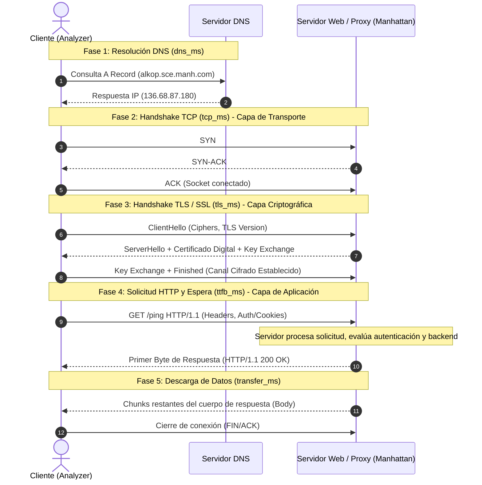

# Manhattan Latency Analyzer 🚀

**Manhattan Latency Analyzer** es una solución de monitoreo y diagnóstico de red multiplataforma (compatible con **Linux**, **Windows** y **macOS**) desarrollada para realizar mediciones continuas y detalladas de latencia hacia endpoints web (por defecto `https://alkop.sce.manh.com/ping`).

---

## 🏢 Manejo de Múltiples Sedes y Días (Sin Confusión de Resultados)

Para evitar que los resultados se confundan al realizar pruebas en **diferentes días o desde diferentes sedes/oficinas**, la aplicación incluye un **Sistema de Etiquetado por Sede (Location Tagging)**:

1. **Etiquetado por Sede**: En el menú `⚙️ Configuración`, puedes asignar el nombre de la sede actual (ej. `Sede Bogotá`, `Sede Medellín`, `Sede Cali`, `Home Office`). Todas las mediciones tomadas desde ese equipo quedarán etiquetadas automáticamente.
2. **Filtro Global por Sede**: En la barra superior de la aplicación web se incluye el selector **"Filtrar por Sede / Ubicación"**. Permite consultar de forma independiente las métricas de una sede específica o seleccionar *"Todas las Sedes"*.
3. **Panel de Comparativa entre Sedes**: Se incluye un panel de análisis comparativo que muestra en paralelo el promedio de latencia total, DNS, TCP, TLS y TTFB de cada sede registrada.
4. **Registro con Timestamp UTC y Local**: Cada medición registra la fecha y la hora exacta en formato estándar ISO 8601, lo que permite auditar qué ocurrió en cada día y rango horario.
5. **Exportación Filtrada a CSV**: Puedes exportar el archivo CSV filtrando por sede específica o fecha para entregar informes independientes por oficina.

---

## 📊 Desglose de Fases de Latencia Medidas

| Fase | Métricas | Descripción |
| :--- | :--- | :--- |
| **1. Resolución DNS** | `dns_ms` | Tiempo transcurrido para resolver el nombre de dominio a su dirección IP (`136.68.87.180`). |
| **2. Conexión TCP** | `tcp_ms` | Tiempo que toma establecer el Handshake TCP de la capa de transporte (Socket connect). |
| **3. Negociación TLS / SSL** | `tls_ms` | Tiempo dedicado a la negociación del canal cifrado SSL/TLS (peticiones HTTPS). |
| **4. Espera del Servidor (TTFB)** | `ttfb_ms` | **Time To First Byte**: Tiempo desde que se envía la solicitud HTTP hasta recibir el primer byte de respuesta del servidor. |
| **5. Transferencia de Datos** | `transfer_ms` | Tiempo de lectura del cuerpo completo de la respuesta del servidor. |
| **6. Latencia Total** | `total_ms` | Tiempo acumulado end-to-end (`DNS + TCP + TLS + TTFB + Transfer`). |

---


---

## 🔬 Sustento Técnico del Análisis de Tiempos y Fases de Conexión

Para comprender con exactitud qué mide cada fase y cómo interpretar los resultados de diagnóstico, este analizador implementa una arquitectura de medición secuencial de bajo nivel basada en la pila de protocolos **TCP/IP** y el modelo **OSI**.



---

### 1. Desglose Matemático y Metodología de Medición (`probe.py`)

Todas las mediciones se realizan mediante temporizadores de alta resolución (`time.perf_counter()`), garantizando precisión de fracciones de milisegundo sin dependencias externas:

$$\mathbf{T_{\text{Total}}} = T_{\text{DNS}} + T_{\text{TCP}} + T_{\text{TLS}} + T_{\text{TTFB}} + T_{\text{Transfer}}$$

1. **Resolución DNS (`dns_ms`)**:
   - **Mecanismo:** `socket.gethostbyname(hostname)`
   - **Qué mide:** Tiempo de consulta hacia los servidores de nombres configurados en el sistema operativo para resolver el FQDN (`alkop.sce.manh.com`) en la IP destino (`136.68.87.180`).
2. **Conexión TCP (`tcp_ms`)**:
   - **Mecanismo:** `sock.connect((ip, port))`
   - **Qué mide:** Tiempo exacto del *3-Way Handshake* de TCP (`SYN` → `SYN-ACK` → `ACK`). Es la medida más pura de **latencia de ida y vuelta de red (1 RTT)** hacia el balanceador o servidor.
3. **Negociación TLS/SSL (`tls_ms`)**:
   - **Mecanismo:** `ssl_context.wrap_socket(sock, server_hostname)`
   - **Qué mide:** Negociación criptográfica sobre el socket TCP previamente abierto. Incluye intercambio de llaves Diffie-Hellman/ECDHE, validación de la cadena de certificados y establecimiento de sesión segura (1 a 2 RTTs + tiempo de cálculo de CPU).
4. **Time To First Byte (`ttfb_ms`)**:
   - **Mecanismo:** Desde `sock.sendall(req_headers)` hasta la llegada del primer byte `sock.recv(1)`.
   - **Qué mide:** El tiempo de tránsito de la petición + el tiempo interno de procesamiento del servidor web y aplicación Manhattan + tiempo de retorno del primer byte de encabezados.
5. **Transferencia de Datos (`transfer_ms`)**:
   - **Mecanismo:** Bucle de lectura de buffers (`sock.recv(8192)`) hasta el cierre del socket o fin del `Content-Length`.
   - **Qué mide:** Capacidad del enlace y throughput para descargar el contenido devuelto.

---

### 2. Comparativa Técnica: Analyzer vs Chrome DevTools vs cURL

Existe una diferencia conceptual importante en cómo las herramientas de la industria agrupan la conexión de red:

| Fase | **Manhattan Latency Analyzer** | **Google Chrome DevTools** *(Resource Timing W3C)* | **cURL** (`curl -w`) |
| :--- | :--- | :--- | :--- |
| **DNS** | `dns_ms` | `DNS Lookup` (`domainLookupEnd - domainLookupStart`) | `time_namelookup` |
| **TCP** | `tcp_ms` *(Medición aislada del socket)* | Incluido dentro de **`Initial Connection`** | `time_connect - time_namelookup` |
| **TLS** | `tls_ms` *(Medición aislada del cifrado)* | **`SSL`** *(Mostrado como sub-barra dentro de Initial Connection)* | `time_appconnect - time_connect` |
| **TCP + TLS** | `tcp_ms + tls_ms` *(Suma analítica)* | **`Initial Connection`** (`connectEnd - connectStart`) | `time_appconnect - time_namelookup` |
| **Espera Servidor** | `ttfb_ms` | `Waiting for server response` | `time_starttransfer - time_appconnect` |
| **Descarga** | `transfer_ms` | `Content Download` | `time_total - time_starttransfer` |

> [!NOTE]
> **¿Por qué medir TCP y TLS por separado?**  
> En Chrome DevTools, la etiqueta *"Initial Connection"* abarca la conexión completa (`TCP + SSL`). Nuestro analizador los desacopla deliberadamente para permitir un diagnóstico de causa raíz mucho más granular (diferenciar fallas de enlace físico de saturación del terminador TLS).

---

### 3. Matriz de Diagnóstico y Causa Raíz (Troubleshooting)

| Síntoma Observado | Métrica Elevada | Causa Raíz Probable | Acciones Recomendadas |
| :--- | :--- | :--- | :--- |
| **Latencia intermitente al inicio** | `dns_ms` alto (>50 ms) | Servidor DNS local o corporativo sobrecargado, fallas de caché o consultas recursivas lentas. | Verificar configuración de DNS primario/secundario; revisar DNS resolver en la sede. |
| **Latencia generalizada en todas las fases** | `tcp_ms` alto (>100 ms) | Problema de infraestructura física, distancia geográfica (RTT elevado), congestión en el proveedor de internet (ISP) o enlace WAN saturado. | Realizar traceroute / MTR hacia `136.68.87.180`; revisar saturación de ancho de banda o canal SD-WAN. |
| **TCP normal pero conexión lenta** | `tls_ms` alto (>150 ms) | Sobrecarga de CPU en el servidor web/proxy de Manhattan; validación de certificados CRL/OCSP lenta o ciphers suites pesados. | Validar si el endpoint soporta TLS 1.3 (0-RTT / 1-RTT); verificar estado del terminador SSL/Load Balancer. |
| **Conexión veloz pero respuesta lenta** | `ttfb_ms` alto (>300-800 ms) | Cola de peticiones en el servidor de Manhattan, base de datos ocupada, retraso en middleware de autenticación (Active Directory/SSO). | Inspeccionar rendimiento de la aplicación web y servidores de aplicación Manhattan. |
| **Descarga lenta en payloads grandes** | `transfer_ms` alto | Pérdida de paquetes, ventana TCP pequeña (`TCP window scaling`) o ancho de banda insuficiente en la sede. | Verificar calidad del enlace y pérdida de paquetes en la red local. |

---

### 4. Impacto de la Autenticación en las Mediciones

1. **Sin Autenticación (Petición anónima directa):**
   - El endpoint puede responder con `HTTP 401 Unauthorized` o `HTTP 403 Forbidden`. En este escenario, el `ttfb_ms` es más bajo porque el servidor rechaza la petición rápidamente sin consultar servicios de identidad.
2. **Autenticación NTLM v2 (Dominio Active Directory):**
   - Requiere un handshake de desafío/respuesta (`Type 1 Negotiate` → `Type 2 Challenge` → `Type 3 Authenticate`) sobre el mismo socket TCP/TLS.
3. **Autenticación con Cookie de Sesión / Bearer (MFA Microsoft / Azure AD SSO):**
   - Permite simular con exactitud la experiencia de un usuario logueado en producción.
   - El servidor valida la cookie criptográfica y ejecuta la lógica completa del endpoint, entregando **`HTTP 200 OK`** y reflejando el tiempo de respuesta real que perciben las terminales de radiofrecuencia (RF) o navegadores en operación.

---

### 5. Métricas Estadísticas Avanzadas

- **Percentil P95 y P99:** El percentil 95 indica el valor por debajo del cual se encuentra el 95% de las peticiones. Es el estándar de oro en SLAs de sistemas de misión crítica (WMS/SCE), ya que los promedios suelen esconder picos esporádicos graves (*micro-bursts*).
- **Jitter (Desviación Estándar):** Mide la variabilidad o consistencia temporal de la conexión. Un Jitter bajo (<10 ms) indica un canal sumamente estable; un Jitter alto (>50 ms) refleja inestabilidad en la ruta, fluctuación Wi-Fi o saturación intermitente del canal de subida.

## 🛠️ Requisitos de Sistema

- **Python 3.8+** (utiliza únicamente la librería estándar de Python; no requiere instalar paquetes mediante `pip` ni dependencias externas).
- Navegador web moderno (Chrome, Edge, Firefox, Safari).

---

## 🚀 Instrucciones de Ejecución

### En Linux / macOS:
```bash
./run.sh
```
*O ejecutando directamente:*
```bash
python3 app.py
```

### En Windows:
Ejecuta haciendo doble clic en:
- **`run.bat`** (Windows CMD)
- **`run.ps1`** (Windows PowerShell)

---

## 🌐 Acceso al Dashboard Web

Ingresa a tu navegador en:
👉 **[http://localhost:8080](http://localhost:8080)**
